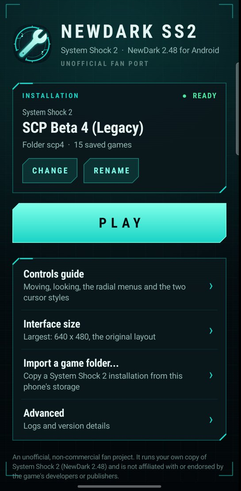

# NewDarkAndroid

**An unofficial, community-made Android port of System Shock 2 (NewDark 2.48), built from your own copy of the game.**

> **Status: v0.1.0-beta.1, a source-only beta.** It plays System Shock 2 and the System Shock 2 Community Patch (SCP)
> on an ARM64 Android phone or tablet with a touchscreen. It is not affiliated with, endorsed by or sponsored by
> Nightdive Studios, Looking Glass Studios, the SCP team or any other rights holder.
> "System Shock" and "System Shock 2" belong to their owners.

## What this is, and what it is not

System Shock 2's engine source has never been released. This project **recompiles the retail 32-bit x86 `SS2.exe`
(NewDark 2.48) into C** with the tools from [Owloeb/NewDarkRecompiled](https://github.com/Owloeb/NewDarkRecompiled),
runs it on a portable host layer (SDL 2, OpenGL ES, DirectX/Win32 shims), and adds an Android app around it: a launcher,
a game-folder importer and full touchscreen controls.

**This repository contains no game.** It has no System Shock 2 code, no recompiled/generated C, no game assets, no
saves and no APK. You build the port on your PC from a copy of the game you own; the generated code stays on your
machine. **Do not distribute APKs you build**: they contain code generated from a copyrighted executable.

## Features

- Plays the game: new game, the intro and start cutscenes (Indeo 5), save/load, level changes, audio, PDA and inventory. See [known limitations](docs/android/KNOWN_LIMITATIONS.md) for what has and has not been played through.
- **Touch controls**: floating stick, swipe-to-look, FIRE (drag to aim), USE, JUMP, CROUCH, RELOAD, a LOOK/CURSOR mode
  toggle, direct or trackpad-style (relative) cursor, an on-screen keyboard and a layout editor.
- **Radial menus anchored to the button you hold** for weapons, ammo and firing modes, psi powers, hypos and patches, and
  the system menu, labelled from the game's own state.
- **Launcher** with installation picker, rename, interface size, a controls guide and a game-folder importer (Android's
  folder picker; no storage permission).
- **Mod support**: data mods (DML, scripts, assets, `cam_mod.ini` order) work as on PC. Native `.osm` modules work if
  they were recompiled into your build. Two NVScript versions are supported side by side, chosen at run time by the
  file's identity: **SCP Beta 8** and **NVScript 1.2.4 (SCP Beta 4)**.
- A physical keyboard and mouse (USB or Bluetooth) work alongside touch. Gamepads are not supported.
- Upgrading the app keeps your saves, settings and imported games.

## Requirements

| | |
| --- | --- |
| Device | Android 8.0+ (API 26), **ARM64** (`arm64-v8a`), OpenGL ES 2.0, a touchscreen. Developed on a Galaxy S26 Ultra (Android 17); not tested on any other device |
| Game | A legitimate **System Shock 2 with the NewDark 2.48 executable** (GOG or Steam; the 25th Anniversary Remaster is a different engine and does not work). `SS2.exe` must be the retail 2.48 file: 5,121,024 bytes, sha256 `c7ff08c5a1837942410cc2328b4a6579ddb1d5a2678b8274db8b0347ce19823e` |
| PC for building | Windows (tested) or Linux with Python 3, JDK 17, Android SDK + NDK (see [docs/android/BUILDING.md](docs/android/BUILDING.md)) |

## Getting started

1. **Build** the APK on your PC against your own game: [docs/android/BUILDING.md](docs/android/BUILDING.md).
2. **Install** it (`adb install`), then put the game on the phone: [docs/android/GAME_FILES.md](docs/android/GAME_FILES.md).
3. **Play** with the [touch controls guide](docs/android/CONTROLS.md).
4. Using SCP or other mods? See [docs/android/MODS.md](docs/android/MODS.md).
5. Trouble? See [docs/android/TROUBLESHOOTING.md](docs/android/TROUBLESHOOTING.md) and
   [docs/android/KNOWN_LIMITATIONS.md](docs/android/KNOWN_LIMITATIONS.md).

## Layout of the repository

| Path | What |
| --- | --- |
| `lift.py`, `lift_*.py`, `host/`, `runtime/`, `tools/`, `harness/`, `symbols/` | The recompiler and Windows host (upstream NewDarkRecompiled, MIT, with our changes) |
| `port/` | The portable host: Win32/DirectX/DirectSound shims, SDL 2 + GLES backend, the Android entry point |
| `port/backends/android/touch/` | The touch controls (**GPL-3.0-or-later**, derived from Shockolate) |
| `video/` | The built-in Indeo 5 cutscene decoder (unmodified FFmpeg, LGPL-2.1) |
| `android/` | The Android app (Gradle), the native build script and test tools |
| `docs/android/` | User and developer documentation for the Android port |
| `docs/android-audit/` | The development history: phase reports and test results (evidence files withheld) |
| `docs/release/` | Release notes, licensing review and publication checklist |
| `docs/UPSTREAM_README.md` | The upstream project's README (Windows and Linux hosts, recompiler internals) |

## Licensing

Mixed, per directory. Short version: the tools are MIT; the touch controls are GPL-3.0-or-later; FFmpeg's Indeo decoder
is LGPL-2.1; SDL 2 (fetched at build time) is zlib; **the game, and anything generated from it, is not licensed to you
by this repository at all.** Details and the full attribution list: [LICENSING.md](LICENSING.md) and
[THIRD_PARTY_NOTICES.md](THIRD_PARTY_NOTICES.md).

## Credits

- **[Owloeb/NewDarkRecompiled](https://github.com/Owloeb/NewDarkRecompiled)**: the static recompiler, Windows/portable
  hosts and the DirectX/Win32 layers this port stands on. Without it there is nothing here.
- **[Shockolate](https://github.com/Interrupt/systemshock)** (GPL-3.0-or-later) and its Halo-derived Android touch-control
  design: the touch-control core (floating stick, look, FIRE/USE, radial selector, settings and layout editor).
- **[SDL](https://libsdl.org)**, **[FFmpeg](https://ffmpeg.org)** (Indeo 5 decoder), and Android NDK/SDK.
- **Looking Glass Studios** made System Shock 2; **Nightdive Studios** maintain the rights. The NewDark engine updates this port
  targets are the work of Tom N Harris and the NewDark contributors. The **System Shock 2 Community Patch** is the work of
  its own team. None of them is involved in, or responsible for, this project.

This is a fan project made for people who already own the game.
