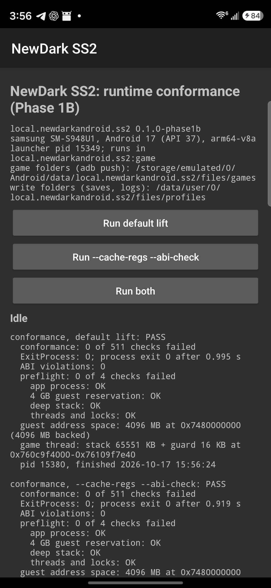
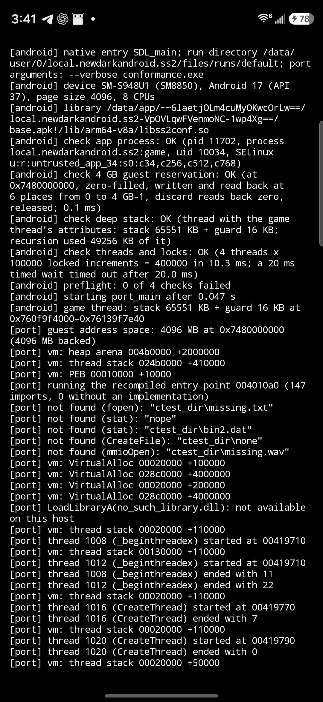

# Phase 1B results: Android application bring-up

2026-10-17. Goal: a real Android APK, not an `adb shell` executable, that runs the portable runtime and the game-free
conformance suite inside an ordinary app process on the Galaxy S26 Ultra and reports the results reliably.

**Out of scope, and not done:** no game code was built or run, Shockolate was not touched, and no touch controls,
NVScript or SCP work was started. Nothing was pushed.

## Summary

| Item | Result |
| --- | --- |
| APK | `local.newdarkandroid.ss2` 0.1.0-phase1b, arm64-v8a, debug-signed. Two activities in two processes, with SDL 2.32.10. |
| Launch and library load | The launcher cold-starts in about 200 ms. In the `:game` process SDL loads `libSDL2.so` and the test library, then calls `SDL_main`. |
| App sandbox | uid 10034, SELinux `u:r:untrusted_app_34`, process `local.newdarkandroid.ss2:game`, recorded in every run log. |
| 4 GB guest reservation | **Succeeds in the app:** `guest address space: 4096 MB at 0x7480000000 (4096 MB backed)`. The preflight probe also passes. |
| Conformance, default lift | **0 of 511 failed**, `ExitProcess(0)`, exit 0. 10 of 10 in-app runs pass. |
| Conformance, `--cache-regs --abi-check` | **0 of 511 failed**, 0 ABI violations, exit 0. 8 of 8 in-app runs pass. |
| Results display | The verdict, preflight checks, guest space, stack and pid are on screen and in logcat `RESULT …` lines (screenshots below). |
| Shutdown and relaunch | 5 force-stop/cold-relaunch cycles, a Back-button exit and relaunch from the icon, and an app update: all clean. |
| Unexpected native crashes | **None.** The crash buffer was empty after every positive run. |
| Failure reporting | Checked with 2 deliberate failures. A bad exe is reported as FAIL with `exit 2`. A SIGSEGV is reported as FAIL `NATIVE CRASH: signal 11` with a tombstone. The launcher survives both. |
| Phase 1A `adb shell` regression | Both modes still pass after the CMake change. |
| NewDark 2.48 | **Not present** on this PC. All copies are 2.47 (or 2.46 backups). See §6. |

**Phase 1B's completion criterion is met.** A real APK launches on the S26 Ultra, runs the portable runtime's
conformance suite inside the app process with 0 failures in both lift modes, and reports results reliably. That
includes reliable reporting of failures and crashes.

## 1. Device and toolchain

| | |
| --- | --- |
| Device | Samsung Galaxy S26 Ultra `SM-S948U1`, serial `<serial>`, Snapdragon `SM8850`, 8 CPUs |
| OS | Android 17 (API 37), build `S948U1UES4BZIG`, kernel `6.12.69-android16-6`, **4 KB pages**, SELinux enforcing |
| NDK / clang | `29.0.14206865` (r29), clang 21.0.0; `ANDROID_PLATFORM=android-26` |
| CMake / Ninja | SDK `3.22.1` / `1.10.2` |
| Java / Gradle / AGP | Temurin 17.0.20, Gradle 8.7 (wrapper), AGP 8.5.1. Built offline from the local Gradle cache, with no new downloads. |
| SDK levels | compileSdk 34, targetSdk 34, minSdk 26 |
| SDL | 2.32.10 (`5d2495703`). Read-only local clone of the copy the Shockolate build uses, in `build/deps/SDL2` (git-ignored). |
| APK | `android/app/build/outputs/apk/debug/app-debug.apk`, 5,861,842 bytes, sha256 `33e6397e…867e878f` (final build) |

**APK contents.** The libraries are stored uncompressed and 16 KB-aligned (`zipalign -c -P 16` passes). The ELF LOAD
alignment is `0x4000`, so they would also load on a 16 KB-page kernel; that is unverified.

| File | Size in the APK (stripped) |
| --- | --- |
| `lib/arm64-v8a/libSDL2.so` | 1.4 MB |
| `lib/arm64-v8a/libss2conf.so` | 1.0 MB |
| `lib/arm64-v8a/libss2conf_cr.so` | 1.6 MB |
| `assets/conformance/conformance.exe` | 139 KB |

The unstripped libraries are 11.6 MB and 11.5 MB and stay in `build/android/conformance/*/host/` for symbolication.

## 2. Design

```
LauncherActivity  (main process)       test screen, later the launcher; never runs native game code
    | startActivity(lib, args)               files/runs/<mode>/{conformance.exe, run.log, status}
    v
NewDarkActivity extends SDLActivity  (":game" process, a fresh one per run)
    SDL loads libSDL2.so + lib<lib>.so, calls SDL_main(run dir, port args...)   on SDLThread
        android_main.c: run.log + logcat, status file, crash handler, 4 preflight checks
        port_main on the "ss2-game" pthread, 64 MB stack
        port_exit -> exit -> __wrap_exit: "exit N" to status, _exit
    process ends -> ActivityTaskManager removes the activity -> LauncherActivity resumes, reads status + run.log
```

**Why two processes**

- `port_exit` calls `exit()`, and the host sets its state up once per process.
- With two processes, the visible app survives every native exit or crash. Each run starts clean.
- The game in Phase 2 will use the same arrangement: quitting the game returns to the launcher.
- Both processes are ordinary app processes: same uid, same `untrusted_app_34` domain, no `adb shell` involvement.

**Why SDL now**

- Phase 2 needs `SDLActivity`, `libSDL2.so` and an `SDL_main` entry. They are already in place, built, and checked
  on the device.
- SDL's Java sources are compiled straight from the SDL tree; none are copied into this repository.
- The test library itself makes no SDL calls (null backend).

**Why `_exit` instead of `exit`**

- Calling `exit()` from a native thread runs atexit handlers and library destructors while ART threads and guest
  threads are still running. That is a known source of shutdown crashes on Android.
- `__wrap_exit` flushes stdio, fsyncs the log and status files, and calls `_exit(code)`.

**Native build outside Gradle**

- `android/build_native.py` reuses `run_conformance.py`'s guest build and lift. It builds:
  - SDL2;
  - `libss2conf.so`: the default lift;
  - `libss2conf_cr.so`: `--cache-regs`, `PORT_ABI_CHECK=ON`.
- Both libraries come from the same `conformance.exe`.
- Gradle only packages the result. The real game is lifted on the PC first, and its generated C is too large to
  rebuild inside every Gradle sync.

## 3. Changes

| File | Change |
| --- | --- |
| `port/CMakeLists.txt` | +23 lines, all under `if(ANDROID)`. **Visibility:** `CMAKE_C_VISIBILITY_PRESET hidden`. **New target:** a shared library `lib${PORT_ANDROID_LIB}.so` (default `main`) built from the system part, the backend, `backends/android/*.c` and the generated objects. It links `log` and `-Wl,--wrap=exit,--wrap=plat_log_write`, plus SDL2 when `PORT_BACKEND=sdl2`. The executable is unchanged; non-Android builds are unaffected. |
| `port/backends/android/android_main.c`, `README.md` | New. `SDL_main`, logcat and file log, status file, crash handler, preflight checks, the 64 MB game thread, `--android-crash-test`. |
| `android/` | New Gradle project. `LauncherActivity`, `NewDarkActivity`, `Files`, the manifest, `build.gradle`, the Gradle 8.7 wrapper, `build_native.py` and `README.md`. |
| `docs/android-audit/PHASE1B_RESULTS.md`, `phase1b/` | This report, 2 screenshots and one in-app run log |

No change was made to `runtime/`, `port/core`, `win32`, `crt`, `dx`, `backends/posix`, `backends/null`,
`backends/sdl2`, the lifter, or the generated code.

`plat_posix.c`'s `plat_log_write` and libc `exit` are replaced at link time in the Android library only.

`nm` on the libraries shows:

- the only dynamic export is `SDL_main`;
- `exit` is no longer imported at all;
- the ABI checker (`abi_*` symbols) is present only in `libss2conf_cr.so`.

## 4. Test evidence

Collected with `adb logcat`, `run-as` (to read app files), `screencap` and `dumpsys`. Raw logs are in
`build/android/evidence/` (git-ignored). The final in-app `--cache-regs` log is in `phase1b/run-cr.log.txt`.

### 4.1 In-app runs (S26 Ultra)

The result history on the device has 22 entries:

- **18 positive runs, all PASS:** 10 default and 8 `--cache-regs --abi-check`.
- **4 deliberate negative runs, all FAIL as expected.**

| Scenario | Runs | Result |
| --- | --- | --- |
| First install, `--es autorun all` | 2 | PASS. Default exit 0 after 1.10 s; cr after 0.89 s. |
| After an app update (`install -r`), `autorun default` | 1 | PASS |
| **5 cycles:** `am force-stop`, then cold `am start -W … --es autorun all` | 10 | 10/10 PASS. Each run in a new pid. Launch `TotalTime` 185-218 ms. Crash buffer empty. |
| Back-button exit (the activity is gone from the task), relaunch from the launcher icon, tap **Run both** | 2 | PASS. Confirms the on-screen buttons. |
| A default run while the overlay is visible (screenshot) | 1 | PASS |
| Final APK, cold start, `autorun all` | 2 | PASS (pids 15380 and 15492) |
| Negative: `missing.exe` (`--es autorun neg`), twice | 2 | FAIL, as expected. `cannot read missing.exe`, `exit 2`. |
| Negative: `--android-crash-test`, twice | 2 | FAIL, as expected. Status `signal 11 code 1 addr 0x10`, shown as `NATIVE CRASH`. debuggerd wrote a tombstone for thread `ss2-game` in the `:game` process. The launcher kept the focus, and no crash dialog appeared. |

The pid and timing come from the final runs.

Typical `RESULT` line (logcat tag `NewDarkLauncher`):

```
RESULT mode=cr verdict=PASS conformance=0/511 preflight=0/4 abi_violations=0 exitprocess=0 status="exit 0" pid=15492 seconds=0.919
```

**Verdict rule.** A run is PASS only if **all** of these hold:

- the status file says `exit 0`;
- `conformance: 0 of N checks failed` appears with N > 0;
- `[port] ExitProcess(0)` appears;
- the preflight reports 0 failures;
- there are 0 `ABI VIOLATION` lines in the run's logs.

A missing status line, a signal, or a process that died without a status is reported as FAIL, with the reason.

**Lifecycle seen in logcat.** After every run:

1. `Process local.newdarkandroid.ss2:game (pid …) has died: fg TOP`
2. `Force removing ActivityRecord{… NewDarkActivity}: app died, no saved state`
3. The launcher resumes, which `dumpsys` confirms (`topResumedActivity=…LauncherActivity`).

### 4.2 What the preflight and runtime showed in the app sandbox

Every run, both modes:

| Area | Evidence |
| --- | --- |
| Initialisation | `native entry SDL_main` 1-4 ms after `nativeRunMain`. `port_main` started 47-59 ms after entry. `running the recompiled entry point 004010a0 (147 imports, 0 without an implementation)`. |
| Guest memory | Preflight: 4 GB `plat_mem_reserve` at `0x7480000000`. It reads as zero, a write and read-back works at 6 points from 0 to 4 GB-1, a discard reads back zero, and the release works (0.1 ms). Then `vm_init`: `guest address space: 4096 MB at 0x7480000000 (4096 MB backed)`. Only 6 MB is touched in a run. No `--guest-space` was needed. |
| Stack | Game thread `ss2-game`: 65,551 KB stack plus a 16 KB guard. Preflight probe: 49,256 KB of real recursion on a thread with the same attributes. Inside the suite: deep guest recursion and 420 nonlocal jumps with an unchanged stack position. |
| Synchronisation | Preflight: 4 threads × 100,000 increments under `plat_mutex` = 400,000 in 8-10 ms. A 20 ms timed wait times out after 20.0-20.5 ms. Suite: guest threads 1008/1012/1016/1020 end with 11/22/7/0; critical sections, events, interlocked operations and timers pass. |
| Filesystem | The suite's `stdio` section runs in `files/runs/<mode>/` (internal storage). The expected `not found` probes appear. |
| Logging | Every line is in logcat (`ss2port`) and in `run.log`. Levels map debug/info/warn/error to logcat priorities. |

### 4.3 Phase 1A regression (`adb shell` executable)

The hidden-visibility preset changes compile flags for the Android executable too, so both modes were re-run:

```
run_conformance.py --target android --serial <serial> --build build/conf-android --no-rebuild-guest
    conformance: 0 of 511 checks failed / [port] ExitProcess(0) / conformance (null, android): PASS
run_conformance.py … --cache-regs --abi-check --build build/conf-android-cr --no-rebuild-guest
    ABI check: 0 call site(s) broke the calling-convention contract / PASS
```

These are a regression check only. **They are not evidence for the app.** The in-app evidence is §4.1.

### 4.4 Screenshots

| Test screen after a run | Overlay during a run (`:game` process) |
| --- | --- |
|  |  |

## 5. Issues found during the work

1. **Autorun after an app update.** After `adb install -r`, Android 17 / One UI put a system
   `PackageUpdateActivity` into the app's task. The first `am start --es autorun neg` was not picked up.
   - A repeat delivered the extra through `onNewIntent`, and so did a reinstall-and-start with logging added. The first
     miss was not reproduced.
   - The launcher now logs every autorun request.
   - **Workaround for scripted runs:** `am force-stop` before `am start`. All formal runs used it.
   - This affects `adb` automation only, not the app itself.
2. **Thread name.** The game thread first inherited the name `SDLThread`, so tombstones were misleading. It is now
   named `ss2-game`, and the probe thread `ss2-stackprobe`.
3. **Device storage is 95% full** (27 GB free on `/data`). That is enough for SS2 (a few GB, about 2× during an
   import), but worth knowing before copying modded installs.

## 6. Preparing for game execution

### 6.1 NewDark 2.48: not present

Read-only search of every local drive (`C:`, `D:`, `E:`, `Z:`; depth 6; version resources only):

| Path | ProductVersion | Size |
| --- | --- | --- |
| `<LaunchBox install>\ss2.exe` | **2.47** | 5,116,416 |
| `<local path>` | 2.47 | 5,116,416 |
| `<local path>` | 2.46 | 5,113,856 |
| `<local path>` | 2.47 | 5,116,416 |
| `<local path>` (+ the same 2 backups) | 2.47 / 2.46 | |

No NewDark 2.48 archive or installer was found either. Nothing was modified.

**Exact requirement**

- The `SS2.exe` from a NewDark **2.48** install:
  - ProductVersion 2.48;
  - built 2019-06-15 with MSVC 2008;
  - PE32 x86 with relocations.
  - Upstream (`NEWDARK.md`, `README.md`) lifted and verified it from a **fresh GOG install**; Steam is also named.
- Its own `Data/allobjs.osm`, `osm/squirrel.osm` and `lgvid.dll`. Upstream found the first two byte-identical to the
  copies it verified.
- A clean install without SS2Tool's `patch_ext` is best for the vanilla baseline (IMPLEMENTATION_PLAN.md).
- `host.c` refuses to run unless the `SS2.exe` it finds has the size and CRC the build was lifted from. The copy on
  the phone must therefore be the same file that was lifted.

A 2.47 exe would lift, but nothing upstream is verified against it. The lifter's SMC, SSE2 and flags findings are
specific to 2.48. **Do not substitute 2.47.**

### 6.2 Smallest changes to get NewDarkRecompiled's graphics on screen in this app

The app already has the processes, `SDL_main`, the big-stack thread, logging, the status file and storage. What
remains:

1. **Build.** Add a game mode to `build_native.py`: lift with `port/build.py`'s lift stage on the PC, then configure
   `port/` with `PORT_BACKEND=sdl2`, `PORT_ANDROID_LIB=main` and `-DSDL2_DIR=build/android/sdl2`. The SDL build tree
   already exports `SDL2Config.cmake`, and the CMake target already links `SDL2::SDL2` for this backend.
2. **`plat_sdl2.c`: three `__ANDROID__` points.**
   - Its `main()` does `SDL_SetMainReady`, `SDL_Init(0)` and the mouse hints before `port_main`. On Android,
     `android_main.c` must run that sequence on the game thread: rename it under `__ANDROID__` and call it instead
     of `port_main`.
   - Skip `SDL_StartTextInput()` at window creation, which would open the soft keyboard.
   - Make GLES the default. `setenv("SS2PORT_GLES","1")` in `android_main.c` does this with no backend change.
3. **`android_main.c`:**
   - `setenv SS2PORT_WRITE_DIR=files/profiles/<name>`;
   - keep `SS2PORT_RENDER_THREAD` off, so the GL context stays on the thread that pumps SDL events across
     pause and resume;
   - skip the 48 MB stack probe for game runs (optional).
4. **`NewDarkActivity`:** `screenOrientation="sensorLandscape"`, immersive mode, and no log overlay once the game
   has a window.
5. **Launcher:**
   - a "Start game" entry that runs `lib main` with `[profile dir, <games>/<name>/SS2.exe]`;
   - before launching, a check that `SS2.exe` exists and matches the lifted size and CRC (§6.1).

**Hardware-dependent risks** (ANDROID_COMPATIBILITY.md §3.2):

- Adreno mediump precision;
- S3TC absent, so DXT textures are decoded on the CPU;
- the EGL surface across pause and resume;
- SDL event pumping from the game thread rather than `SDLThread`. SDL2 supports it, but it is untested here.

### 6.3 Game-file import strategy

**Game assets: read-only, option A of IMPLEMENTATION_PLAN.md §2.**

- **Location:** `/storage/emulated/0/Android/data/local.newdarkandroid.ss2/files/games/<name>/`. The launcher creates
  it and shows it on screen.
- **Copying:** with `adb push` from the PC. No permission is needed.
- **Verified here:** a file pushed by `adb` (owner `shell`, group `ext_data_rw`, mode 0666) is readable by the app's
  uid. The probe file was removed afterwards.
- **POSIX paths** work as `plat_fs_*` requires. No SAF and no complex file browser.

**Saves, configuration and logs: separate, internal storage.**

- Location: `files/profiles/<name>/`, through `SS2PORT_WRITE_DIR`.
- The VFS reads the write folder first and writes only there (`vfs.c:84-106`), so the game folder is never modified.
- Saves are never in the shared-storage folder.

**Android settings:** in `files/` (`SharedPreferences` and later the touch layout), apart from both of the above.

**One game folder per profile.** This keeps vanilla and SCP saves apart.

**Later (Phase 5):** a SAF import that copies into the same `games/` folder, so `adb` refresh keeps working.

## 7. Outstanding blockers and open points

1. **Blocker for any game run:** the owner must obtain a NewDark **2.48** install (§6.1).
2. **Untested:**
   - 16 KB page kernels. The libraries are 16 KB-aligned and the guest uses 64 KB regions, but the device has 4 KB
     pages.
   - MTE.
   - The GL path and the Android pause/resume lifecycle with a real window.
3. **`NewDarkActivity` in a test run shows a black surface under the overlay.** That is expected: the null backend
   draws nothing.
4. **Personal builds only.** The game APK will contain code generated from the owner's files (ANDROID_COMPATIBILITY.md
   §5). This conformance APK contains no game-derived code.

## 8. Commit

Branch `android-port`. One commit: the native entry, the CMake target, the Android project and this report. Nothing
pushed. Build products (`build/`, `android/.gradle`, `android/app/build`) are git-ignored.

## 9. Recommended next step: Phase 1C

1. **Owner:** install NewDark 2.48 (clean GOG or Steam) on the PC.
2. Lift it on the PC. Build the `null`-backend game as `libmain.so` and as the `adb` executable.
3. `adb push` the game folder to `files/games/ss2/`.
4. Run the game headless (`--frames 600`) **inside the app** using this launcher path.
   - Acceptance: `allobjs.osm`, `Squirrel.osm` and `lgvid.dll` load as recompiled modules, "first frame presented",
     exit 0, no guest fault.
   - Repeat with `--cache-regs --abi-check`.
5. Then switch to `PORT_BACKEND=sdl2` with the §6.2 changes for first light.
