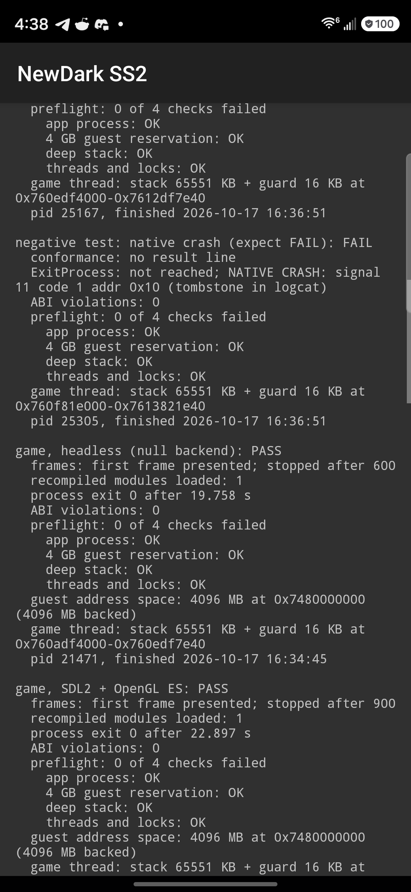

# Phase 1C results: first real game execution

2026-10-17. Goal: run the recompiled NewDark 2.48 System Shock 2 inside the Android APK on the Galaxy S26 Ultra,
first headless, then, as a stretch goal, show its first real frame.

**Out of scope, and not done:** no touch controls, no mod, SCP or NVScript work. Shockolate and the Steam installation
were not modified. Nothing was pushed.

## Summary

| Item | Result |
| --- | --- |
| Game input | Steam `SS2.exe`, ProductVersion 2.48, built 2019-06-15 (MSVC 2008, PE32, relocations). Hashes in §2. |
| Lift (default, no `--cache-regs`) | `SS2.exe`: 21,229 functions in 143 C files. SMC: 242 code writes → 239 patched fields, 1 patched branch, 0 unresolved, the same as upstream. All three modules were lifted. |
| Android build | `libss2null.so` (null backend) and `libss2game.so` (SDL2 + OpenGL ES) for arm64-v8a. 0 warnings and 0 errors in a clean rebuild. Stripped, each is 37.8 MB in the APK. |
| **Game in the app, headless** | **PASS.** Entry point `006f7105`. 364 imports, **0 without an implementation**. `lgvid.dll` loaded as a recompiled module. Direct3D 9 device 800×600. First frame 67 ms after `port_main`. 600 frames, `exit 0` after 19.8 s. |
| **Game in the app, SDL2 + OpenGL ES** | **PASS, and real frames on screen.** OpenGL ES 3.2 on an **Adreno 840**, fullscreen landscape at 2340×1080. The intro cutscene plays with sound and the **main menu renders correctly** (screenshots in §5.3). Three runs of 1200, 1500 and 900 frames all ended with `exit 0`. |
| Audio | DirectSound mixes at 44.1 kHz stereo into SDL. Android shows an OpenSL ES player for the game process, `state:started`, active. I did not listen to it. |
| Keyboard input | Injected `KEYCODE_ESCAPE` skipped the intro: the menu appeared at about 7 s instead of about 15 s. Injected `KEYCODE_3` did nothing visible. This was not investigated. |
| Shared-host bug found and fixed | `_findfirst` and `FindFirstFileA` listed only the write folder when `SS2PORT_WRITE_DIR` was set. The game therefore never saw `install.cfg`, found no resource path, and called through a NULL resource (§4.2). Fixed in `core/vfs.c`. |
| Phase 1B regression | In the new APK: default **0/511**, `--cache-regs --abi-check` **0/511** with 0 ABI violations. Both negative tests still FAIL as designed. Phase 1A `adb` runs and the native Windows conformance hosts (both lift modes) are also 0/511. |
| Crashes | None unexpected. The crash buffer was empty after every game run. The launcher survived every run, including the one fatal guest error before the fix. |

**Phase 1C's success criterion is met:** the recompiled System Shock 2 code runs inside the Android application. **The
stretch goal is also met:** real game frames are on the S26 Ultra's screen (the intro cutscene and the main menu).

This is **start-up, not gameplay.** No mission was loaded. `allobjs.osm` and `Squirrel.osm` are loaded on demand and
were not reached. There is no touch input yet. Pause and resume with a live GL window were not tested (§7).

## 1. Source revision and baseline

| | |
| --- | --- |
| Branch | `android-port`, clean at the start, parent `66e6476a95ece36f41bb7771648525d1681e8592` (Phase 1B) |
| Phase 1C commit | The commit that adds this file. Its parent is `66e6476`. |
| Phase 1B APK preserved | `build/android/baseline/phase1b/app-debug-phase1b.apk`, sha256 `33e6397e…867e878f`, the same as PHASE1B_RESULTS.md. Its three `.so` files and `SHA256SUMS` are alongside (git-ignored). |
| Phase 1C APK | `android/app/build/outputs/apk/debug/app-debug.apk`, `0.2.0-phase1c` (versionCode 2). 117,620,220 bytes, sha256 `c23baf5a…186d92e9`. It holds 80.0 MB of entries. The rest is apparently unused space from Gradle's incremental packaging; I did not investigate. `zipalign -c -P 16` passes (build-tools 36). ELF LOAD alignment is `0x4000`. |
| Toolchain | Unchanged from Phase 1B: NDK r29 (clang 21), SDK CMake 3.22.1 with Ninja, Gradle 8.7 offline, SDL 2.32.10, Python 3.14 venv. |

## 2. Game inputs

`<local path>` is a fresh Steam install. It was only read, never written.

| File | Size | sha256 | CRC32 | PE header |
| --- | --- | --- | --- | --- |
| `SS2.exe` | 5,121,024 | `c7ff08c5a1837942410cc2328b4a6579ddb1d5a2678b8274db8b0347ce19823e` | `c8f2d1e4` | ProductVersion 2.48, 2019-06-15 16:49:09, linker 9.0, base 0x400000, relocations. Imports WINMM, KERNEL32, USER32, GDI32, ADVAPI32, SHELL32, ole32, MSVCP90, MSVCR90. |
| `Data\allobjs.osm` | 547,840 | `096c3a1e25f9751e71cf3e05c834866ad61ebd9fbced8cf3917a4a6e3466a645` | `31a5417c` | 1999-09-10, linker 4.20. **The same hash as upstream's verified module.** |
| `OSM\squirrel.osm` | 2,726,400 | `d95b441565365525c3a208fc7f7ae5d513daac624e85d9a87703de2b5f763dc4` | `6e282a23` | Version 1.02, 2018-10-30, linker 9.0 |
| `lgvid.dll` | 21,504 | `64d55311637315ffcff83eb193a05470a9fb8ded2a2704efcb649d751d8b4eec` | `fe360efe` | 2014-02-22, linker 9.0 |

**Notes on the install**

- The total size is 648 MB, of which `Bonus Content` is 131 MB and `Data` is 496 MB.
- Steam's stock configuration has `cam_mod.ini` with `mod_path patch_ext` and `uber_mod_path osm+ubermod`. It also
  ships `patch_ext.crf` and a `patch\` folder of community-fix CRFs. The game loads `patch\iface.crf` in preference
  to `Data\res\IFACE.CRF`.
- There is no SS2Tool, no mod manager and no NVScript.
- Upstream verified a **GOG** 2.48 install and did not record its `SS2.exe` hash. I could not check whether Steam's
  `SS2.exe` is byte-identical to it.
  - Supporting evidence for the same code: the PE date matches, and the SMC figures match upstream exactly.
  - Against it, or a lifter change since the note was written: this lift finds 21,229 functions where `NEWDARK.md`
    says 21,232.

**On the device:** everything except `Bonus Content` was copied with `adb push` to
`/storage/emulated/0/Android/data/local.newdarkandroid.ss2/files/games/ss2/`. That is 176 files and 518 MB, copied in
3 s. On the device, the `sha256sum` of `SS2.exe`, `allobjs.osm`, `squirrel.osm` and `lgvid.dll` matches the table.

## 3. Build

`python android/build_native.py --no-rebuild-guest --game "E:/Steam Games/steamapps/common/SS2/SS2.exe"`

| Step | Time on this PC | Output |
| --- | --- | --- |
| Lift `SS2.exe` (`lift.py --smc`, default) | 5 min 58 s (Windows Python 3.14; upstream reports about 1 min on Linux) | `gen/nd`: 143 C files, 180 MB |
| Lift `allobjs.osm` (`--iat-indirect`, base unchanged) | 7 s | `gen/ao`: 26 files, 22 MB |
| Lift `Squirrel.osm` (`--rebase 0x30000000`) | 105 s | `gen/sq`: 98 files, 109 MB |
| Lift `lgvid.dll` (`--rebase 0x30300000`) | under 1 s | `gen/lv`: 3 files |
| `libss2null.so` (null) | 68 s | 536.8 MB unstripped, 37.8 MB stripped |
| `libss2game.so` (sdl2) | 67 s | 537.0 MB unstripped, 37.8 MB stripped |

**Configuration**

- The lift uses the same steps and flags as `port/build.py`'s defaults: no `--cache-regs`, no fast paths, no symbol
  table. `build_native.py` imports `port/build.py` for `MODULES`, `sha` and `find_ci`, and writes the same
  `src.sha1` signatures, so unchanged inputs are not lifted again.
- CMake: `RelWithDebInfo`, `ANDROID_PLATFORM=android-26`, `PORT_PREEMPT=ON`, `PORT_VIDEO=ON`, `PORT_SHADERS=ON`,
  `PORT_PPL=OFF`.
- Upstream compiles generated code with `-w`.
- Everything is in `build/android/game/` (git-ignored). **No generated source or binary is committed or distributed.**

**SDL2 for CMake.** The SDL build tree's `SDL2Config.cmake` includes `sdlfind.cmake`, which exists only in an install.
Phase 1B's §6.2 assumption that the build tree was enough was wrong. `build_native.py` now builds `SDL2main` and
installs SDL into `build/android/sdl2-install/`, then points `SDL2_DIR` there.

## 4. Running the game

### 4.1 How it runs

- The launcher has two new modes, `game-null` and `game`, each with a button and an `--es autorun` value.
- Both run `games/ss2/SS2.exe` in a fresh `:game` process, with these arguments:
  `<run dir> --verbose --android-env SS2PORT_WRITE_DIR=files/profiles/ss2 --frames N <exe>`.
- `--ei frames N` overrides the frame limit (600 headless, 3600 windowed by default).
- **Verdict for a game run:** `exit 0`, preflight 0 failures, `first frame presented`, and no `[port] FATAL`.
- **Game assets are read only.** The game folder is owned by `shell`, mode `r-X` for others, so the app's uid cannot
  write it. All writes go to `files/profiles/ss2/`; so far that is only `SS2.log`.

### 4.2 First run: a fatal guest error, and its cause

The first in-app run failed after 0.077 s:

```
[port] FATAL: call or jump to 00000000, which is neither recompiled code nor a host function
[port]   guest stack: 004aff46 ...     (thread 1004, the main thread)
```

The guest code at `0x4aff34` is a resource lookup:

1. It calls `nd_004b0110("fontpal", …)`.
2. It reads the returned object's vtable and calls entry 3.
3. The lookup returned NULL. Guest page 0 reads as zero, so the call went to 0. On Windows this would be an access
   violation.

**Finding the cause.** The `adb shell` executable was linked from the same objects, so I could add `--trace-only`
without reinstalling. The file-call trace showed:

- `fopen("cam.cfg")` succeeded;
- `_findfirst64i32("install.cfg")`, `("shock.cfg")` and `("user.cfg")` all returned -1, although the files exist.

Without `install.cfg` there is no `resname_base` (`.\Data\res`), so `fontpal` could not be found.

**The cause is in shared host code, not Android code.**

- `vfs_map(".")` resolves to the **write folder** whenever it exists, because reads look there first.
- `_findfirst` (`crt/stdio.c`) and `FindFirstFileA` (`win32/kernel32_file.c`) open only that one host folder.
- So with `SS2PORT_WRITE_DIR` set, a listing never shows the game folder's files.
- Every platform is affected when it uses a write folder, which upstream's README recommends.
- The conformance suite runs without a write folder, so it never saw this.

**Fix (+32 lines in `core/vfs.c`, 6 in `core.h`, both shims switched over).**

- New calls `vfs_opendir`, `vfs_readdir` and `vfs_closedir` list the write folder's copy and then the game folder's.
- A name in both is listed once, from the write folder. The case-insensitive check uses the existing listing cache.
- Both shims use these calls. Their glob, stat and output code is unchanged.

**Result:** the next run reached `Direct3D 9: device 800x600` and `first frame presented`, ran 600 frames and exited
with 0.

### 4.3 In-app results (S26 Ultra)

All runs started cold: `am force-stop`, then `am start -W … --es autorun <mode>`. Launch `TotalTime` was 203-246 ms.

| Run | Result | Details |
| --- | --- | --- |
| `game-null` (before the folder permissions were fixed) | FAIL, as it should | The launcher reported `no game: …/SS2.exe not found`. `adb push` creates folders `shell:ext_data_rw` mode 2770, which the app cannot enter (§6, item 2). |
| `game-null` (before the VFS fix) | FAIL, as it should | `[port] FATAL` (§4.2), `exit 2` after 0.077 s. The launcher reported it and survived. |
| `game-null`, 600 frames | **PASS** | `exit 0` after 19.758 s. `port_main` started at +0.051 s, the entry point at +0.064 s, and the D3D9 device and first frame at +0.118 s. 600 frames took 19.6 s, with no input, during the intro. |
| `game`, 1200 frames | **PASS** | `exit 0` after 25.893 s. The intro played from +0.13 s to about +16 s (lgvid threads 1016 and 1020), then the main menu. |
| `game`, 1500 frames, Escape at about 4 s | **PASS** | `exit 0` after 18.600 s. The intro was skipped, and the menu was on screen by about 7 s. |
| `game`, 900 frames, audio check | **PASS** | `exit 0` after 22.897 s. `dumpsys audio` showed an active OpenSL ES player for this pid. The run log is `phase1c/game-sdl2-run.log.txt`. |

The headless run log is `phase1c/game-null-run.log.txt`.

**What every successful run showed**

- The `:game` process (uid 10034, `untrusted_app_34`) died and its activity was removed.
- `LauncherActivity` resumed, as `topResumedActivity` confirms.
- The crash buffer was empty.

### 4.4 Phase 1C validation checklist

| Check | Status | Evidence |
| --- | --- | --- |
| Native game initialisation | Verified | Entry point running, 364 of 364 imports bound, CRT and `SS2.log` set up, configuration read (`cam.cfg`, `install.cfg`, `cam_mod.ini`, `cam_ext.cfg`) |
| Module loading | Partly verified | `lgvid.dll` loads as a recompiled module (60 imports, `DllMain` → 1), and its two decoder threads ran the intro. `allobjs.osm` and `Squirrel.osm` are loaded by the game only when a game starts. They were not reached, but they are built in. |
| Guest memory mapping | Verified | 4096 MB at `0x7480000000`, fully backed. 26 MB touched by the menu. Heap arena, thread stacks, PEB, `VirtualAlloc` and big-block allocations all appear in the logs. |
| Headless game loop progress | Verified | 600 frames presented and counted by the host, then `exit 0`. Guest threads 1008-1024 started and ended normally. |
| SDL2 / OpenGL ES initialisation | Verified | `OpenGL ES 3.2 V@0842.19.13 / Adreno (TM) 840`, RGBX8888 surface, window 2340×1080 landscape |
| Actual graphical output | **Verified** | Screenshots of the Irrational logo cutscene and the main menu (§5.3) |
| Audio initialisation | Verified at the platform level | `DirectSound: mixing to 44100 Hz stereo`; OpenSL ES track active. Not heard. |
| Clean exit or correctly reported failure | Verified | Every run ended with `exit 0`, or was reported as FAIL with its reason (`exit 2`, missing game) |
| No regression in Phase 1B | Verified | §5.2 |

## 5. Other evidence

### 5.1 Changes

| File | Change |
| --- | --- |
| `port/core/vfs.c`, `core.h` | `vfs_opendir/readdir/closedir`: folder listings that merge the write folder and the game folder (§4.2) |
| `port/crt/stdio.c`, `port/win32/kernel32_file.c` | `_findfirst*` and `FindFirstFileA` use those calls (+13/-14 lines in all) |
| `port/backends/sdl2/plat_sdl2.c` | Under `__ANDROID__` only: `main` is renamed `plat_sdl2_main`, and `SDL_StartTextInput` is skipped (it would open the on-screen keyboard). Other platforms are unchanged. |
| `port/backends/android/android_main.c`, `README.md` | `--android-env NAME=value`. Uses `plat_sdl2_main` when it is linked (a weak symbol). For SDL2 builds, sets `SS2PORT_GLES=1`, `SS2PORT_FULLSCREEN=1` and landscape orientation, and clears `SS2PORT_RENDER_THREAD`, so GL and event pumping stay on the game thread. |
| `android/build_native.py` | `--game`, `--game-only`, `--game-backend`. Lift as in `port/build.py`, two game libraries, SDL install for CMake. |
| `android/app/…/LauncherActivity.java`, `NewDarkActivity.java`, `build.gradle` | Game modes, `--ei frames`, game verdict and RESULT line. Landscape and no overlay for the game window. Version 0.2.0-phase1c. |
| `android/README.md`, `docs/android-audit/README.md`, this report, `phase1c/` | Documentation and evidence: the launcher screenshot and two run logs |

No change was made to the lifter, `runtime/`, `dx/`, the generated code, the Steam install or Shockolate.

The exported symbols are unchanged: `SDL_main` is still the only one. `libss2game.so` needs `libSDL2.so`, and
`libss2null.so` does not.

### 5.2 Regression (same APK, same session)

| Suite | Result |
| --- | --- |
| In-app `autorun all` | default: PASS, 0/511, 0.988 s. cr: PASS, 0/511, 0 ABI violations, 0.905 s. |
| In-app `autorun neg` | `neg-exe`: FAIL (`exit 2`). `neg-crash`: FAIL (`signal 11 code 1 addr 0x10`), with a tombstone. Both as designed. |
| Phase 1A `run_conformance.py --target android` | Default: PASS, 0/511. `--cache-regs --abi-check`: PASS, 0/511, 0 ABI violations. |
| Native Windows hosts (`build/conf-win`, `conf-win-cr`, rebuilt with the changed core) | Both 0/511 with `ExitProcess(0)`. The existing `_findfirst` and `FindFirstFileA` checks pass. |

### 5.3 Screenshots

| | |
| --- | --- |
| Launcher after the runs (committed) |  |
| Intro cutscene at about 4 s, main menu at about 18 s, menu after Escape | `build/android/evidence/phase1c/game-4s.png`, `game-18s.png`, `game-after-esc.png` (git-ignored) |

The game screenshots show the game's own copyrighted art, so they are **not committed**. They are 2340×1080 device
captures.

**What they show**

- The game's 4:3 picture is letterboxed in the middle of the 19.5:9 landscape screen.
- The menu's text, buttons, background and the TriOptimum logo render correctly.
- The arrow cursor shows at the top left of the game picture.
- No GL errors appear in the log.

## 6. Issues found

1. **Shared-host write-folder listing bug.** Fixed (§4.2). This should go upstream with a conformance check that sets
   a write folder. The current suite does not cover it, and adding a check would change Phase 1B's 511-check
   baseline, so that is left for later.
2. **`adb push` permissions.** Folders that `adb push` creates under `Android/data/<pkg>/files/` are
   `shell:ext_data_rw 2770`, and the app's uid cannot enter them. Phase 1B only tested one file in a folder the app had
   created.
   - Fix: `adb shell chmod -R a+rX,go-w <games dir>`. This is in android/README.md.
   - It also enforces that the game assets are read only.
3. **SDL2 CMake package.** The build tree is not usable; an install is (§3).
4. **Git Bash path conversion.** The first push attempt was mangled by Git Bash (`/storage/...` became
   `C:/Program Files/Git/storage/...`). Nothing landed on the device. The push was redone from PowerShell.
5. **The digit key `3` on the main menu** had no visible effect. This was not investigated: the numbers may be labels,
   not hotkeys.

## 7. Remaining blockers and open points

**No blocker remains for the next milestone.** Not yet verified:

- **Gameplay:** New Game, character creation, loading Earth/MedSci, and therefore loading `allobjs.osm` and
  `Squirrel.osm` and running 3D rendering on Adreno. Without touch or mouse input, the menus can only be driven with
  injected keys today.
- **Pause and resume** (Home, Back, screen off) while the GL window is live. `SDL_HINT_ANDROID_BLOCK_ON_PAUSE` is the
  default and the context is on the game thread, but none of this has been tested. The Back key's effect is unknown.
- **Performance.** There is no frame-time instrumentation. Overall numbers only: 1500 frames in 18.6 s, mostly on the
  menu, on a 120 Hz panel.
- **The `--cache-regs` game build.** It was not built in this phase, as instructed.
- 16 KB page kernels, MTE, and the GLES precision and S3TC questions from ANDROID_COMPATIBILITY.md §3.2. None of the
  rendering so far exercised them.
- APK size (§1): 37.8 MB per game library, two variants, plus about 38 MB of apparently unused space.
- **Personal builds only.** The APK now contains code generated from the owner's `SS2.exe`, so it must not be
  distributed.

## 8. Recommended next milestone (Phase 2: into the game)

1. Pause and resume with a live GL context (Home, recents, screen off/on, Back) in the `game` mode. Fix any EGL or
   SDL pause issues in `android_main.c` and `NewDarkActivity` only.
2. Reach gameplay with a **physical keyboard and mouse** or a Bluetooth controller: New Game → Earth → MedSci.
   Confirm that `allobjs.osm` and `Squirrel.osm` load as recompiled modules and that 3D renders correctly on Adreno.
   Save and load into `files/profiles/ss2/`.
3. Add frame-time logging (`--prof` or a per-second fps line). Compare the default lift with `--cache-regs`
   (`--abi-check` for one session).
4. Upstream the VFS fix, with a write-folder conformance check.
5. Only then, the touch controls (TOUCH_CONTROLS.md).
