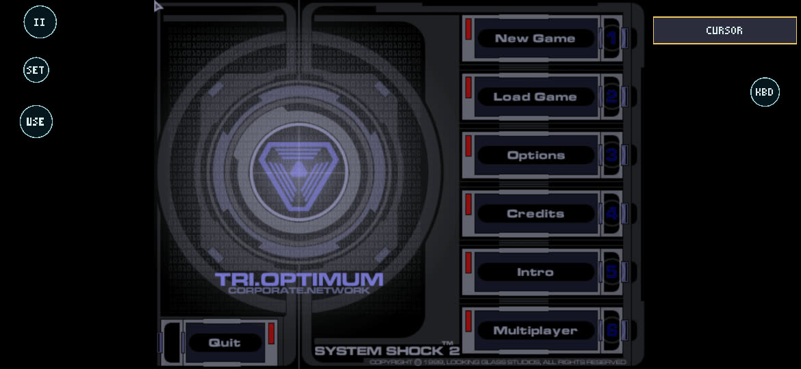
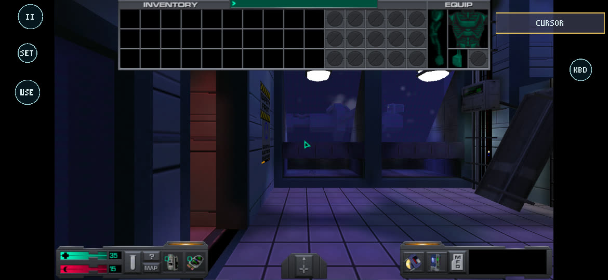
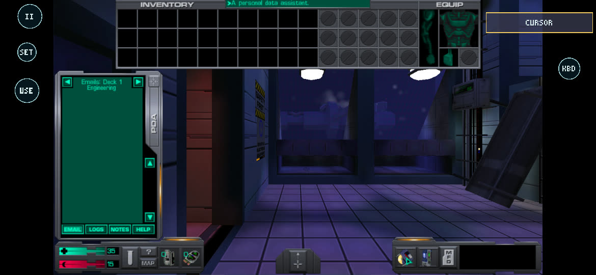

# Phase 2B-2 results: essential touchscreen polish (Milestone A)

2026-10-18 (overnight session). Goal: finish the remaining touch usability items (Android keyboard, default button
placement over the enlarged interface, any missing essential action) without changing the control feel the player
accepted.

**Status: PARTIAL.** The code is done and passes the host tests, and the new layout was checked on the S26 Ultra
from the game's own frames at three resolutions. **No real or HID touch input reached the game during this session**,
so the keyboard button and the acceptance tests (A4) were not exercised on the device. A third-party app on the phone,
`io.japp.blackscreen` ("Black Screen", version 2.0.7), had a full-screen `APPLICATION_OVERLAY` window up all night. It
held input focus (`mCurrentFocus=Window{… io.japp.blackscreen}`), took every touch and key, and blacked out
`screencap`. It was left alone: it is the player's app and setting, and stopping it was not part of this task. The game
kept running underneath, which is how the frame captures below were made (§4).

| Item | Result |
| --- | --- |
| A1 Android keyboard | **Implemented, host-tested, not device-tested.** New **KBD** button (right letterbox bar) shows/hides Android's keyboard through SDL's own text input |
| A2 Default placement | **Done; verified on the device by frame captures** at 1280×720, 800×600 and 1024×768: SET, AMMO/USE and KBD in the bars, MODE right of EQUIP. The player's saved layout is upgraded **in memory only** because it was never moved; the file is byte-identical |
| A3 Missing actions | Reviewed. Nothing essential is missing; no radial added (§3) |
| A4 Acceptance tests | Host suites pass (169/169 bridge checks; Shockolate's six core suites). Device touch tests **blocked** (overlay). Gameplay, menus, inventory, PDA, save/load and the HUD were exercised on the device with scripted input instead (§4, and PHASE3B_SCP_RESULTS.md) |
| APK | `0.6.0-phase2b2` (versionCode 7), sha256 `8673f4dcba26de0e4c21e34b08a32d80fec92667cabeb65d89755f36321e3053`, preserved in `build/android/baseline/phase2b2/`. The later `0.7.0-phase3a` APK contains the same touch code |





## 1. Starting point and preservation

| | |
| --- | --- |
| Repository | `android-port`, clean, HEAD `f366189` (Phase 2B-1), no changes since |
| Phase 2B-1 APK | `build/android/baseline/phase2b1/app-debug-phase2b1.apk`, sha256 `9850e11c…af507511`, verified unchanged |
| Device backup | `build/android/backup/pre-overnight-2026-10-18/app-files.tar` (5.4 MB, SHA256SUMS beside it): `files/profiles`, `files/touch-settings.cfg`, `files/results` |
| After the session | Every file of `profiles/ss2` (saves 0–2, `current/`, `cam.cfg`, `user.bnd`, `user.cfg`) and `touch-settings.cfg` is byte-identical to the backup; only `SS2.log` differs (one vanilla menu test). Tests used separate game folders and profiles (`ss2test`, `ss2scp`, `ss2scp-nonv`) with copies |
| Storage | PC 197 GB free; phone 26 GB free |
| Shockolate | Only read (`git show`/`git archive` of `7502370`), unchanged |

## 2. Changes

| File | Change |
| --- | --- |
| `touch_settings.c/.h` | The hidden `target` slot becomes **KBD** (`.955, .25`, radius .04), so the settings file format (keys, schema v3) is unchanged. New defaults: SET `.045, .19`, AMMO `.045, .33` (both in the left bar), MODE `.905, .0825` (its left edge at 1908 px, right of EQUIP's 1884 px at 16:9). `touch_settings_upgrade_layout()`: a stored layout whose every control is still exactly at the Phase 2A/2B-1 default (and not resized) gets the new positions; stick size, opacity, look speed and haptics are kept. A layout with any control moved or resized is left as it is |
| `touch_controls.c` | One condition: KBD takes a touch in cursor mode too (as AMMO does), so it works on the save screen and in menus |
| `touch_ss2.c/.h` | KBD calls the platform's `keyboard` callback. `typing`: while the keyboard is up in look mode, a new finger only reaches II, KBD, MODE and SET, so typing in the console cannot walk, turn or fire. Cursor mode is unchanged (the save screen's buttons stay usable) |
| `touch_ss2_android.c` | `SDL_StartTextInput`/`SDL_StopTextInput` (text rectangle 0,0 1×1, so nothing pans). SDL keeps text events on from start-up without a keyboard, so whether it is up is tracked here; Android's Back closes it (SDL then stops text input) and text events are switched back on for physical keyboards. Held touch controls are released when it opens or closes (in the next poll, not inside the core's callback). Logs `keyboard shown/hidden` and the layout upgrade |
| `touch_render_gles.c` | KBD is drawn in cursor mode too, and lit while the keyboard is up |
| `AndroidManifest.xml` | `NewDarkActivity`: `windowSoftInputMode="adjustNothing\|stateHidden"`: the keyboard slides over the game, the picture never pans or resizes |
| `tests/touch_ss2_test.c` | KBD in look and cursor mode, typing lock-out (stick, look, fire ignored; II still Esc), default positions at 16:9 (bar buttons inside the bars, MODE right of EQUIP, no overlaps), layout upgrade (never-moved upgraded, moved kept bit for bit, file round trip) |

**How typed text reaches the game (from SDL 2.32.10's source, not observed on the device).** SDL's `SDLInputConnection`
generates a key press and release for every ASCII character the keyboard commits (`nativeGenerateScancodeForUnichar`,
with Shift for capitals and symbols) and then the text (`SDL_TEXTINPUT`). The host turns those into DirectInput key
state plus `WM_CHAR`, exactly what a physical keyboard produces, which already works for the console and save names
(Phase 1D/2B-1 used a HID keyboard). The keyboard's Enter arrives as a key event; Backspace too (or as generated
`\b` on Android 10 and earlier). `:` (the console, `bind : edit_command`) comes as Shift + `;`.

## 3. Missing actions (A3)

Checked against the game's `user.bnd`. Everything needed to play is reachable: movement, look, fire, use, jump,
crouch, reload, ammo, weapon cycling, the menu, interface mode (inventory, equipment, PDA, MFDs, map, psi, hacking and
research, quick-bind slots through the HUD), and now text. Not on a button, and judged not essential: direct weapon
keys 1–0, F1–F12 quick-use, lean Q/E, quicksave/quickload (Alt+S/L; the Esc menu saves and loads), message history.
A weapon radial (Shockolate's selector) would only speed up what `<`/`>` already do, so none was added.

## 4. Device results

The overlay meant no touch reached the game, so the game was driven by the host's own scripted input
(`SS2PORT_INPUT_SCRIPT`, which feeds the same events a keyboard, mouse or touch placement produces), and new
**frame capture** (`SS2PORT_SHOT_DIR`, an input-script `shot` command; reads the GL back buffer before the swap, so it
works under any overlay) recorded what the game showed. These checks are of rendering and placement, not of touch.

| Check | Result | Evidence |
| --- | --- | --- |
| Touch settings load | `settings … (loaded); layout never moved: current default positions (file unchanged)` | run log |
| Menu at 1280×720 | II, SET, USE (cursor-mode AMMO) in the left bar; KBD in the right bar; CURSOR box right of the menu | `menu-1280x720.jpg` |
| Inventory and EQUIP at 1280×720 | CURSOR box starts right of EQUIP's armour slot (no overlap) | `inventory-1280x720.jpg` |
| PDA at 1280×720 | SET clear of the PDA; USE in the bar beside the PDA's previous arrow, not on it | `pda-1280x720.jpg` |
| Inventory at 800×600 and 1024×768 | All buttons in the bars, CURSOR beside EQUIP | `inventory-800x600-1024x768.jpg` |
| Gameplay at 1280×720 | Stick, FIRE, USE, JUMP, CROUCH, `<` `>`, RELOAD as before; AMMO in the bar; KBD in the bar | `gameplay-1280x720.jpg` (SCP Earth) |
| Player's settings file | sha256 `b0ce8f1a…` before and after: not rewritten | §1 |

Not done on the device (blocked): KBD and Android's keyboard (text, Backspace, Enter, Back), the typing lock-out,
physical keyboard alongside, multitouch, inventory drag by touch, suspend/resume with touch held, stuck-input checks.

## 5. Host tests

| Suite | Result |
| --- | --- |
| `port/backends/android/touch/tests/run.sh` | **169/169** (87 before; new: KBD, typing lock-out, default layout, layout upgrade) |
| Shockolate core suites from 7502370 (`touch_controls`, `alpha11`, `alpha2`, `alpha3`, `alpha4`, `ammo`) against this core | All exit 0. Five give output identical to the original core's; `alpha3` differs only in uninitialised values it prints, which it also prints with the original core on this Windows build |

## 6. Manual acceptance checklist (about 10 minutes, once the phone has no overlay)

1. `adb install -r build/android/baseline/phase2b2/app-debug-phase2b2.apk` (or the later APK). Start **Play**.
2. Main menu: KBD at the right edge, II/SET/USE at the left. Load a save.
3. Walk, look, fire, use, jump, crouch as before (nothing about them changed).
4. Tap **KBD**: Android's keyboard appears over the bottom of the game; the picture does not move. Type `:` and
   `summon_obj wrench`, Enter: the console takes it. Swipe on the right half while it is up: the view must not turn.
5. Back closes the keyboard; KBD is no longer lit. Walk again.
6. Esc menu → Save Game → empty slot → KBD → type a name → Enter/Save. Load it.
7. Tab (MODE) into the interface: CURSOR beside EQUIP, not on it; open the PDA: SET and USE beside it.
8. If anything is in the way: **SET** → layout editor still works and saves; your file is then yours and is never
   replaced by new defaults.

## 7. Build and test commands

```sh
build/venv/Scripts/python.exe android/build_native.py --no-rebuild-guest --game "<SS2>/SS2.exe" --game-only --game-backend sdl2
cd android && ./gradlew assembleDebug
CC="build/venv/Scripts/python.exe -m ziglang cc" sh port/backends/android/touch/tests/run.sh
# frame captures under scripted input (no touch needed):
adb shell am start -n local.newdarkandroid.ss2/.LauncherActivity --es autorun game --es game ss2test \
  --es env SS2PORT_INPUT_SCRIPT=/data/user/0/local.newdarkandroid.ss2/files/scripts/lay720.txt,SS2PORT_SHOT_DIR=/data/user/0/local.newdarkandroid.ss2/files/shots
```
