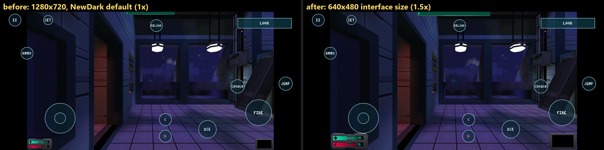
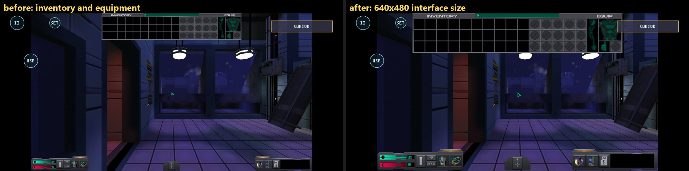
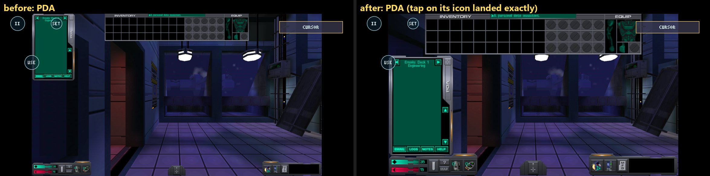
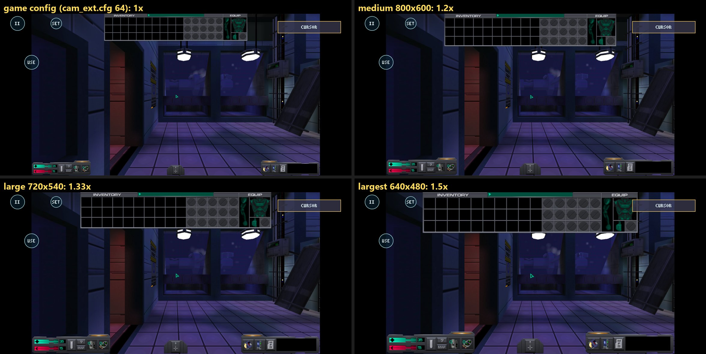
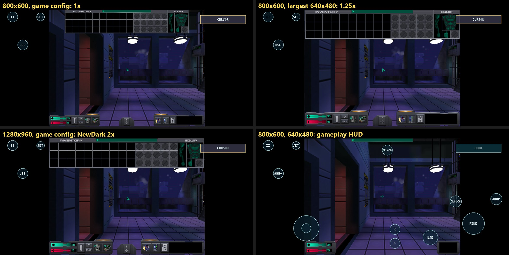
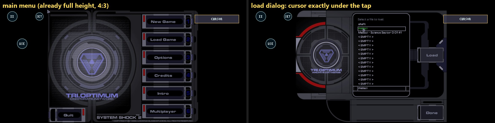

# Phase 2B-1 results: scalable game UI

2026-10-18. Goal: make System Shock 2's own HUD, inventory, PDA, menus and text larger and easier to read on the
Galaxy S26 Ultra, without lowering the 3D resolution and without changing the accepted Phase 2A touch controls.

**Out of scope, and not done:** radial menus, SCP, NVScript, a replacement interface, and any change to the touch
mechanics or default layout. Shockolate, the Steam installation and the generated recompiled C were not changed.
Nothing was pushed.

## Summary

**The success criterion is met.** NewDark's own 2D overlay scaling (`d3d_disp_scaled_2d_overlay`) works in the
recompiled engine and the portable Direct3D 9 frontend without any renderer change. It is now chosen in the launcher
(**Interface size**, default *largest*). At the resolution the player uses (1280×720), the HUD, inventory, equipment,
PDA, email text and console are **1.5× larger**: 2.25 screen pixels per interface pixel instead of 1.5. That is the
size the SS2 interface was laid out for (640×480). The 3D picture keeps its resolution, and the frame rate is
unchanged.

Testing turned up one touch defect, which existed before this phase. At a wide game resolution, the game's 4:3
menus (main menu, load/save, Esc menu) were drawn pillarboxed, but taps were placed as if the menu filled the picture.
Taps landed up to 180 screen px off toward the menu edges. This is fixed: the D3D9 frontend now reports where the
engine drew its 2D picture, and the touch bridge places the cursor through that rectangle.

| Area | Result |
| --- | --- |
| Engine setting | `d3d_disp_scaled_2d_overlay` is read (it appears in `SS2.log`), and a `user.cfg` value overrides the stock `cam_ext.cfg` one. Custom 2D resolutions 800×600, 720×540 and 640×480 work. **NewDark ignores anything below 640×480** (560×420 gave no scaling). |
| Renderer | No change needed: the overlay render target and its scaled draw render correctly (screenshots below) |
| Configuration | Launcher button **Interface size**: largest (640×480, default) / large (720×540) / medium (800×600) / game config. Also `--es uisize`. It writes one marked line in the profile's `user.cfg` and leaves the rest of the file alone. |
| Touch mapping in game | Exact through the scaled HUD: corners (0,0), (1279,0), (0,719), (1279,719) and centre (640,360) of a 1280×720 game |
| Touch mapping in 4:3 menus at 16:9 | **Fixed** (was up to 180 px off). Load Game, a save slot, Load, Save Game, Save and Done were all hit at their real screen positions. |
| Inventory drag | Inventory → weapon slot: "Drag weapon here to equip." during the drag, then "Wrench equipped." Weapon slot → inventory: unequipped. |
| PDA, email, console | Larger and readable (screenshots) |
| LOOK / CURSOR | MODE toggles sent Tab each time. The touch mode followed the game through menus, loads and the inventory. |
| Save / load | In-game save to a new slot, then reloaded: the HUD is still scaled and the wrench is still in the inventory |
| Performance | 97–99 fps at the game's 100 fps cap with scaling on and off, no frame over 50 ms, RSS 280 MB both ways |
| Automated tests | Bridge suite **87/87** (76 + 11 new). Conformance in the app: 0/511 (default) and 0/511 (`--cache-regs --abi-check`). |
| APK | `0.5.0-phase2b1` (versionCode 6), sha256 `9850e11ca452df86a113a78ec0d58e231250ca85b8a60b19c9eb3c62af507511`, installed on the S26 Ultra |





## 1. Starting point and preservation

| | |
| --- | --- |
| NewDarkAndroid | `android-port`, clean, at `69cc62c` (Phase 2A frame-limit fix) |
| Phase 2A APKs preserved | `build/android/baseline/phase2a/app-debug-phase2a.apk` and `phase2a-fix/app-debug-phase2a-fix.apk` (`38fa5fcb…6ab8a51`, unchanged) |
| Phase 2B-1 APK | `build/android/baseline/phase2b1/app-debug-phase2b1.apk` (`9850e11c…af507511`) and its `libss2game.so` (`6567d78f…0775f8`), in `SHA256SUMS` |
| Player profile on the phone | Backed up before testing (`tar` of `files/profiles/ss2`). Afterwards `cam.cfg`, `user.bnd` and every file of `save_0`–`save_2` are byte-identical to the backup. The one save written by the test (`save_3`) was removed. `user.cfg` is new: the launcher's Interface size line. |
| Player's own settings | The profile's `cam.cfg` (written by the game at 01:42, before this phase) has **`game_screen_size 1280 720`**. So the player had moved from Phase 2A's 800×600 to a 16:9 resolution. Tests used that resolution. 800×600 and 1280×960 were tried with a temporary `cam.cfg`, and the player's file was put back (checksum checked). |
| Steam install | Read only: no file in it is newer than the start of the phase |

## 2. Investigation

### 2.1 What makes the interface small

The Android presentation is **not** the cause. The game picture already fills the screen height: 1920×1080 at x = 210
for a 16:9 game, or 1440×1080 at x = 450 for 4:3. The cause is how NewDark sizes its 2D layer:

- The SS2 interface (HUD, inventory, PDA, MFDs, text) is drawn in game pixels, laid out for 640×480. At 1280×720 it is
  drawn at 1:1, so it takes only 480/720 of the height: **1.5 screen px per interface px** on this phone.
- Stock `cam_ext.cfg` already has `d3d_disp_scaled_2d_overlay 64`, NewDark's automatic **whole-number** scaling. It only
  scales once the game has at least 960 lines (2× from 1280×960). At 720 lines it does nothing.
- Raising the game resolution therefore makes the interface **smaller**, until 960 lines.

### 2.2 Three different "sizes"

| What | How it is drawn | Room to grow on this phone |
| --- | --- | --- |
| Main menu, load/save, Esc menu, options | A 640×480 image fitted to the picture by `ui_scale_mode 2`, already the full 1080-line height (2.25 px per menu px) | **None** without cropping: it is already as tall as the screen |
| Whole game image | Fitted to the screen height | **None**: it is already full height. Making it larger would crop it. |
| HUD, inventory, PDA, in-game text | The game's 2D overlay, in game pixels | **Yes**: `d3d_disp_scaled_2d_overlay` |

So the change that helps is the overlay scaling. The menus were already as large as the screen allows, and they only
needed the touch fix in §3.

### 2.3 `d3d_disp_scaled_2d_overlay` in the recompiled engine

NewDark's documentation is in stock `cam_ext.cfg`. With `64`, it scales in whole steps (pixel perfect). With
`W H`, it uses a fixed 2D resolution, "aspect ratio corrected and scaled up to the current resolution". Results on the
S26 Ultra with a profile `user.cfg` (copies only, Steam folder untouched):

| Setting in `user.cfg` | `SS2.log` | Result at 1280×720 | Screen px per interface px |
| --- | --- | --- | --- |
| none (stock `64`) | `d3d_disp_scaled_2d_overlay 64` | 1× | 1.5 |
| `800 600` | `… 800 600` | scaled | 1.8 |
| `720 540` | `… 720 540` | scaled | 2.0 |
| `640 480` | `… 640 480` | scaled; the HUD spans the 16:9 picture (NewDark widens 480 lines to 853) | **2.25** |
| `560 420` | `… 560 420` | **ignored: 1×**. NewDark does not go below 640×480. | 1.5 |

- `user.cfg` overrides `cam_ext.cfg` (cam.cfg includes it, and the last value wins). Only one value is logged.
- The portable renderer needed no change. The overlay is drawn into a render target and then over the 3D frame, with
  the D3D9 features the frontend already implements.
- Scaling at non-whole ratios is filtered (slightly soft), as NewDark documents. `d3d_disp_force_filter_scale2d` was
  not needed.




At 4:3 resolutions the result is the same size: the interface takes 480 of the picture's lines.

| Game resolution | game config (`64`) | largest (`640 480`) |
| --- | --- | --- |
| 800×600 (Phase 2A) | 1.8 px | 2.25 px |
| 1280×720 (the player's) | 1.5 px | 2.25 px |
| 1280×960 | 2.25 px (NewDark's own 2×) | 2.25 px |
| 1920×1080 (not tested; computed) | 2.0 px (2×, 540 lines) | 2.25 px |



## 3. Touch defect found: 4:3 menus at a wide resolution

At 1280×720, NewDark draws its 640×480 menus into 160,0 960×720 of the frame, but it maps the window cursor onto the
menu **by scaling the whole window** (menu x = window x × 640 / 1280). Phase 2A's bridge put the cursor at the game
pixel under the finger, which is right only when the menu fills the frame: at 4:3, as in all Phase 2A tests. At 16:9 a
tap on **Load** (screen x 1742) put the menu's cursor at screen x ≈ 1609, 133 px to the left, off the button. The error
grows to 180 px at the menu edges and is zero at the centre. In-game (inventory, PDA) was not affected: the HUD covers
the whole frame.

**Fix:**

- `port/dx/d3d9.c`: each frame, the frontend notes where the engine drew its 2D picture into the back buffer: the
  largest of a `StretchRect` from a surface of at least 512×384, or a pre-transformed textured quad (2 triangles at
  most, texture of at least 512×384) covering at least 45 % of the frame. A frame without one reports the whole back
  buffer. `d3d9_ui_rect()` returns the last presented frame's rectangle. A changed rectangle is logged (`Direct3D: 2D
  picture at …`, at most 200 lines). The cost is an early-out test per draw. Menus give `160,0 960x720`; in game (scaled
  HUD or not) and at 4:3 it is the whole frame.
- `touch_ss2.c` / `touch_ss2_android.c`: once per poll the bridge takes that rectangle (`ss2t_ui_rect`). When it is
  not the whole picture, a placed cursor is mapped through it: game x = (x − rect x) × game width / rect width, clamped.
  A tap beside the menu goes to its edge. Nothing else in the bridge or the Shockolate core changed.
- Taps in game, and at 4:3 resolutions in menus, are mapped exactly as in Phase 2A.



## 4. Implementation

| File | Change |
| --- | --- |
| `android/app/…/LauncherActivity.java` | **Interface size** button (cycles largest → large → medium → game config; stored with the launcher's settings); `--es uisize 640x480\|720x540\|800x600\|game`; before each game start, `applyUiSize` rewrites the line after the marker `; NewDarkAndroid launcher, Interface size: …` in `files/profiles/ss2/user.cfg` (atomic replace; other lines kept; *game config* removes only the marked lines, and the file if nothing else is in it). Logged as `interface size: …`. |
| `android/app/build.gradle` | `0.5.0-phase2b1`, versionCode 6 |
| `port/dx/d3d9.c` | The 2D picture rectangle (§3), +42 lines, no rendering change |
| `port/backends/android/touch/touch_ss2.[ch]`, `touch_ss2_android.c` | `ss2t_ui_rect` and the mapping through it; the Android glue reads `d3d9_ui_rect` through a weak reference and logs a changed rectangle with `SS2PORT_TOUCH_DEBUG=1` |
| `port/backends/android/touch/tests/touch_ss2_test.c` | `test_ui_rect_mapping`: a 1280×720 game, a menu at 160,0 960×720, the menu's corners and centre, the Load button, taps beside the menu, and an unchanged mapping for the whole picture |
| `android/README.md`, `port/backends/android/touch/README.md`, this folder's README | Documentation |

Why `user.cfg` rather than a renderer setting: it is NewDark's own, documented mechanism. It keeps the original layout,
aspect ratio and pixel art, and it scales every 2D element the engine draws in game (HUD, inventory, PDA, MFDs, text,
console, cursor) together. The 3D frame and its resolution are not touched. Doing the same in the renderer would mean
redrawing the engine's 2D draws at another scale, with its own layout and hit-testing problems.

The Shockolate overlay is drawn by the Android glue over the whole surface after the game's frame, so it is
independent of the game's UI scaling. Its size and positions are unchanged.

## 5. Device validation (S26 Ultra, `0.5.0-phase2b1`, 1280×720, largest)

Input came from the HID test touchscreen (`uhid_input -t`, real Android multitouch pointers). The console command used
to get an item came from the HID keyboard (`uhid_input`).

| Check | Result | Evidence |
| --- | --- | --- |
| Main menu → Load Game → slot → Load at true screen positions | ✓ (Phase 2A build: Load missed by 133 px) | `cursor at 976,190` / `565,118` / `1148,289`; screenshots |
| Gameplay HUD | ✓ 1.5× larger, 3D unchanged | `hud-1280x720.jpg` |
| Inventory and equipment | ✓ | `inventory-1280x720.jpg` |
| PDA icon tap, PDA, email | ✓ exact; text readable | `pda-1280x720.jpg`, `email-and-drag.jpg` |
| Taps at the picture corners and centre (cursor mode) | ✓ (0,0) (1279,0) (0,719) (1279,719) (640,360) | `corners.jpg`, log |
| Pick up (`summon_obj wrench`, then touch USE) | ✓ "Wrench picked up." | |
| Drag inventory → weapon slot, then back | ✓ "Drag weapon here to equip.", "Wrench equipped.", unequipped to another slot | `email-and-drag.jpg` |
| LOOK ↔ CURSOR | ✓ Tab down/up on every MODE tap. The mode followed the game through the main menu, loading, the Esc menu and the inventory. | log |
| Esc menu → Save Game → empty slot → Save | ✓ `save_3` written (medsci1, 1.5 MB) | `save-load.jpg` |
| Esc menu → Load Game → that save → Load | ✓ wrench kept, HUD scaled | `save-load.jpg` |
| Levels 800×600, 720×540, 640×480; 560×420 ignored | ✓ | `levels-1280x720.jpg`, `below-640x480-ignored.jpg` |
| 800×600 and 1280×960 game resolutions | ✓ | `resolution-4x3.jpg` |
| Launcher button cycles and keeps other `user.cfg` lines | ✓ (a test `user.cfg` with two lines of its own kept both) | `launcher.jpg` |
| Frame rate (`SS2PORT_PROFILE=1`) | ✓ no change | `profile-1280x720.txt` |
| Conformance in the app (`--es autorun all`) | ✓ 0/511, 0/511 | |

`phase2b1/touch-mapping-run.log.txt` has the touch and rectangle log of a run. `phase2b1/SS2.log-excerpt.txt` has the
engine's view of the setting.

## 6. Limitations

- **640×480 is the engine's limit.** NewDark ignores smaller 2D resolutions, so 2.25 screen px per interface px is the
  largest the original layout can be on this 1080-line screen. Going further would need a renderer-side rescale of the
  engine's 2D draws, with overlapping panels (the PDA, inventory and status bar already take the full 480 lines). It
  was not attempted.
- **Menus cannot grow.** They are already full height.
- **Touch buttons over the game's panels at 16:9.** These are Phase 2A's default positions, which were placed for a 4:3
  picture with 450 px bars:
  - at any size, SET sits over the top-left panel area (the PDA at 1×);
  - with the largest size, the cursor-mode USE ring sits beside the PDA's "previous" arrow and the email portrait. A tap
    on the arrow still reached the game (tested), but the spot is tight;
  - the MODE box covers about 30 px of the right edge of EQUIP's armour slot.

  At 4:3 resolutions (800×600, 1024×768, 1280×960), only the MODE/EQUIP strip remains. The player can move buttons
  with **SET** (Shockolate's layout editor). The defaults were not changed here: the brief keeps the accepted layout.
- **The rectangle detection is a heuristic** on how NewDark 2.48 presents its frames: a large textured 2D quad or a
  `StretchRect` into the back buffer. Something else drawing such a quad in game would also be taken as "the 2D picture".
  None was seen (movies, post effects and the HUD all cover the whole frame). The rectangle is logged when it changes,
  so a wrong one would show in `run.log`.
- **Non-whole scaling is slightly soft** (bilinear), for example 1.5× at 1280×720. 1280×960 with game config gives a
  pixel-perfect 2×, at the same size as the largest setting.
- Not tried by a person yet. All taps came from the HID test touchscreen.
- 1920×1080 was not run; its row in §2.3 is computed.

## 7. Build, install, try

```sh
build/venv/Scripts/python.exe android/build_native.py --no-rebuild-guest --game "<SS2>/SS2.exe" --game-only --game-backend sdl2
cd android && ./gradlew assembleDebug && adb install -r app/build/outputs/apk/debug/app-debug.apk
adb shell am start -n local.newdarkandroid.ss2/.LauncherActivity --es autorun game                     # Interface size as set (default: largest)
adb shell am start -n local.newdarkandroid.ss2/.LauncherActivity --es autorun game --es uisize game    # NewDark's default sizes
CC="build/venv/Scripts/python.exe -m ziglang cc" sh port/backends/android/touch/tests/run.sh            # 87 checks
```

**Manual check (about 5 minutes):** on the launcher, check **Interface size: largest**, then **Game: SDL2 window**. Load a
save. Look at the health/psi bars, then tap **LOOK** (→ CURSOR): the inventory, PDA icon and text should be clearly
larger than before. Tap the PDA icon and open an email. Drag an item between inventory and equipment. Tap **II** →
**Load Game**: the slot you touch should be the one highlighted. To compare, cycle the button to *medium* or *game
config* and start again.
