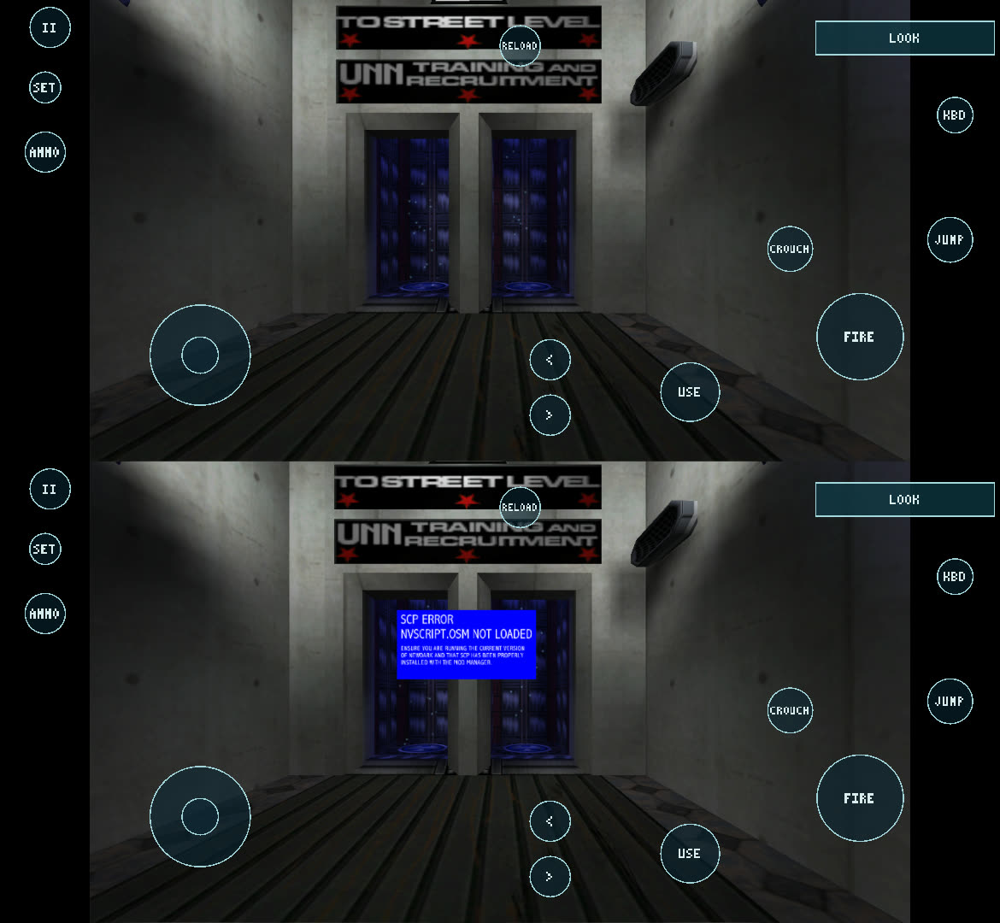

# Phase 3A results: NVScript.osm in NewDarkRecompiled (Milestone B)

2026-10-18 (overnight session). Goal: run the native NVScript script module that the System Shock 2 Community Patch
(SCP) needs, by extending the existing module recompilation, not by emulating it, and prove that its scripts execute.

**Status: PASS.** SCP Beta 8's own `NVScript.osm` is recompiled, links into the portable host, loads, initialises,
and its scripts run on the Galaxy S26 Ultra (arm64) and on Windows (x86-64). The proof is behavioural. SCP blocks the
first grav shaft on Earth with "SCP ERROR: NVSCRIPT.OSM NOT LOADED" when the module is missing. With the recompiled
module the block is gone and the player rides the lift, while the same run without the file is blocked (§5). The
engine calls into the module about 4,000–7,400 times every 20 s of play.

| Stage | Result |
| --- | --- |
| 1. Recompiles | Yes: 4,521 functions, 203,322 instructions. Unsupported instructions left as faults are only in CPU-gated CRT paths and data (§3) |
| 2. Links into the portable host | Yes: Android arm64 (`libss2game.so`, `libss2null.so`) and Windows x86-64 (`ss2port.exe`, null backend) |
| 3. Loads | Yes: `NVScript.osm: loaded the recompiled module at 30400000 (77 imports bound)`; the code CRC check passes |
| 4. Initialises | Yes: static TLS slot set up, `DllMain -> 1`, `SS2.log`: `Loaded script module "nvscript.osm"` |
| 5. Script classes register | Yes: the engine creates and calls NVScript script objects (first call into its code during mission load; thousands of calls) |
| 6. Gameplay scripts execute correctly | Yes for what was tested: SCP's module gate opens only with the module (positive and negative runs, both platforms), the Earth lift ride, save and reload with the module re-initialised (PHASE3B_SCP_RESULTS.md). Not every NV script class SCP uses was exercised |



## 1. The module

| | |
| --- | --- |
| Source | `<downloads>\SCP_beta8.7z` (the user's download), 37,710,819 bytes, sha256 `bcf547c7bd3a38ccb26e6918d72d74e567dc69b138c1ffcb975ea6d165ddb3f6`. Its `readme.txt`: "Beta 8 - December 25, 2025". Extracted with 7-Zip 26.02 into `build/scp/SCP_beta8/` (1,407 files); the archive is unchanged |
| File | `NVScript.osm` at the archive root, 704,512 bytes, sha256 `f15fc91b276e73ad52d5026a86a7d51b83e5644a20c3e58a53a10a4b52d4f11a` |
| Version information | FileDescription "NVScript Shock2 OSM", InternalName "NVScript Script Module", "Copyright (C) 2024 Nameless Voice", FileVersion "." (none given). PE timestamp 1763820538 = 2025-11-22 |
| Toolchain (PE header) | **MSVC 2017** (linker 14.16), 32-bit, image base 0x10000000, size 0xB2000, relocations, static CRT (VS2017), load-config directory (security cookie, SafeSEH table; Control Flow Guard not enabled), **static TLS** (8-byte template, no callbacks) |
| Exports / imports | `_ScriptModuleInit@20`; KERNEL32 (76 functions), USER32 (`GetAsyncKeyState`) |
| Not used | The 1.2.4.0 module in the PC's older install (`<local path>` and `DMM\SCP_beta4`, sha256 `abed4ee2…9a6a`, 662,016 bytes, MSVC 2008, 2017). SCP Beta 8 ships its own newer build, which is the one its missions were made with |
| Dependencies | `Squirrel.osm` (the Steam 2.48 install's `osm\squirrel.osm`, already recompiled) and `allobjs.osm`. `earth.mis` lists the modules `allobjs`, `nvscript`, `squirrel` |

The Phase 0 audit expected an MSVC 2008 module like `squirrel.osm`. This build is newer, and that changed the work:
compiler-generated SSE2 code everywhere (MSVC's 32-bit default since 2012), thread-safe statics through static TLS,
and the VS2017 CRT's start-up.

## 2. Changes

| File | Change |
| --- | --- |
| `lift_sse.py` (new) | SSE/SSE2 translation for the lifter: scalar and packed float/double arithmetic, min/max, sqrt, compares (`comiss`, `ucomiss`, `cmpXXss/sd/ps/pd`), conversions (incl. truncating and MXCSR-rounded float→int with x86's "integer indefinite"), moves (`movss`/`movsd`/`movaps`/`movups`/`movdqa`/`movdqu`/`movd`/`movq`/`movlpd`/`movhpd`/`movlhps`…), logic, unpacks, shuffles, `pextrw`/`pinsrw`, SSE2 integer add/sub/compare/min/max/shift/`pmovmskb`, `stmxcsr`/`ldmxcsr`. Anything else raises Unsupported as before (an `RT_FAULT_UNIMPL` at run time) |
| `lift.py` (+40 lines) | Routes SSE instructions to `lift_sse.py` (before the string ops: `movsd`/`cmpsd` with XMM operands are SSE2); `cmovcc`, `bsf`/`bsr`, `xadd`, `cmpxchg`; the MPX `bnd` prefix on `ret`/`jmp`/`call`/`jcc` (MSVC 2017's CRT) is dropped at decode, as `repz ret` already was |
| `runtime/rt.h` | XMM0–7 and MXCSR appended to the CPU struct (earlier fields keep their offsets); MXCSR is stored XORed with its power-on value 0x1F80, so a zeroed CPU struct starts like the CPU; SSE helpers. `rt_cpuid` still reports no SSE, so CRTs keep their x87 paths |
| `port/core/modules.c` | **Static TLS** for recompiled modules (IMAGE_TLS_DIRECTORY): a slot per module, the template copied into every guest thread's TEB block (TEB+0x2000+slot×4 KB; pointer array at TEB+0x2C), for threads that exist at load and every later one; `_tls_index` written; freed on unload. TLS callbacks are refused with a log line (none here). `mod_containing` (for `GetModuleHandleExW`). The first call from outside into each module is logged; `SS2PORT_MODSTATS=1` logs per-module call counts every 20 s |
| `port/core/threads.c` | A registry of live TEBs; new threads get the loaded modules' TLS |
| `port/win32/kernel32*.c` | The 11 imports NVScript's CRT needs that had no shim: `CreateEventW`, `EncodePointer`, `DecodePointer`, `InitializeSListHead`, `InterlockedFlushSList`, `LoadLibraryExW` (the CRT probes `api-ms-win-core-*` DLLs and falls back), `GetModuleHandleExW`, `EnumSystemLocalesW`, `FindFirstFileExA`, `SetFilePointerEx`, `CreateFileW` |
| `port/build.py`, `android/build_native.py`, `port/CMakeLists.txt` | `--nvscript FILE` adds the module (prefix `nv`, rebased to 0x30400000; 0x01140000 with `--low-dll-bases`); without it an earlier lift is dropped. `lift_sse.py` joins the lifter sources whose change relifts everything |
| `harness/sse_test/` (new) | Differential test of the SSE translation against the real CPU (§4) |

The identity check is unchanged: the host maps the file, relocates it and compares the code CRC with the one taken at
lift time. A different `NVScript.osm` (SS2Tool's 1.2.4, another SCP release) is refused and the engine logs
`Failed to load script module`, as for the other modules. No module is loaded that was not recompiled.

## 3. Lift

`python lift.py --iat-indirect --rebase 0x30400000 NVScript.osm nv out/` (the build runs this): 4,521 functions,
203,322 instructions, about 36 MB of C, 11 s. Before `lift_sse.py`: 1,088 `movss`, 194 `movups`, 156 `movq`,
151 `mulss`, … (more than 3,000 SSE instructions, all faults). After, the instructions still left as faults are:

| Left as faults | Why that is acceptable |
| --- | --- |
| `palignr` 18, `pcmpistri` 3, `pinsrb` 1, AVX (`vxorps`, `vpmovmskb`, `vpcmpeq*`, `vzeroupper`, `xgetbv`) | The VS2017 CRT's string/memory routines for SSSE3/SSE4.2/AVX CPUs. They are selected from CPUID, and the host's CPUID reports a CPU without SSE (`IsProcessorFeaturePresent` returns 0 too), so the CRT never takes them |
| `int 0x29` 6 | `__fastfail`: the CRT's abort; ending the game there is right |
| `mov m16, sreg` 25, `push ss` 1 | The CRT's crash-report context capture (`__report_gsfailure`); only reached on a fatal error |
| `in`, `out`, `insb`, `outsd`, `hlt`, `iretd`, `lcall`, `aaa`, `aam` | Data bytes the function finder decoded as code; never executed |

C++ exceptions: `RaiseException` is called from 2 sites, both inside the static CRT's exception machinery, reached
from 4 CRT functions; no NVScript script code calls them directly. The portable host still stops the game on a
`RaiseException` (unchanged), so a C++ exception thrown inside NVScript would end the game with a clear message. None
was seen.

**The existing modules did not change behaviour.** Their lifts were diffed against a copy taken before this phase:
`allobjs.osm` is identical; in `SS2.exe` (75 instructions), `Squirrel.osm` and `lgvid.dll`, **every** removed line is
a former `rt_fault(..., RT_FAULT_UNIMPL)`. They are the same kind of CPU-gated SSE2 CRT routines (`memcpy`,
`memset`, the SSE2 math library), now translated, still never selected.

## 4. Host-side tests

| Test | Result |
| --- | --- |
| `harness/sse_test/run.py` (new): every translated form (435: register and memory operands, all compare predicates, shuffle immediates, shift counts, `cmov` on all 16 conditions, `bsf`/`bsr` incl. 16-bit, `xadd`/`cmpxchg` incl. `lock` and 8/16-bit) run **natively on the PC's CPU** (32-bit x86 program) and as lifted C from the same random states: general registers, flags, XMM0–7, MXCSR rounding (for the conversions that use it), a 4 KB memory buffer | **0 of 435 forms differ in 870,000 trials** (2,000 per form). 154 registers differed only in which NaN propagated when both operands were NaN (the C compiler may swap the operands of a commutative add/multiply); they are reported separately and are NaN either way |
| Generated C | Compiles warning-free with `-Wall -Wextra` (clang 21 / Zig) |
| Conformance, Android (`run_conformance.py --target android`, fresh lift with the new lifter) | **0/511** default; **0/511** `--cache-regs --abi-check`, 0 ABI violations; **0/113** write-dir, game folder unchanged |
| Conformance, Windows native | **0/511**; **0/511** `--cache-regs --abi-check`, 0 ABI violations; **0/113** write-dir |
| Windows desktop (`ss2port.exe`, null backend) with SCP | The same scripted Earth run as on Android: the module loads with its TLS slot, about 4,900–6,000 calls per 20 s, the gate opens, z 5.78 → 18.04 in the lift (`phase3a/windows-*.txt`) |

## 5. On the device (S26 Ultra, `0.7.0-phase3a`)

The SCP folder `games/ss2scp` is a copy of the Steam 2.48 folder plus `DMM\SCP_beta8\` and `cam_mod.ini` with
`mod_path DMM\SCP_beta8+patch_ext` (PHASE3B_SCP_RESULTS.md). New game, Earth, scripted input (the phone's touch
input was held by another app's overlay; see PHASE2B2_RESULTS.md), frame captures from the game:

| Run | `SS2.log` | Run log | Positions at the shaft | Picture |
| --- | --- | --- | --- | --- |
| `ss2scp` (recompiled NVScript) | `Loaded script module "nvscript.osm"` | TLS slot 0, `DllMain -> 1`, first call at 3045d989, 4,023 then 6,004 calls / 20 s | y 28.46 → **36.80**, z 5.77 → **18.02** (in the lift) | no block |
| `ss2scp-nonv` (the same folder without `NVScript.osm`) | `Failed to load script module "nvscript.osm" (error code 126)` | `could not be opened` | stopped at y **29.29**, z **5.00** | blue panel **"SCP ERROR: NVSCRIPT.OSM NOT LOADED"** in front of the shafts |

Logs: `phase3a/android-run-*.log.txt`, `phase3a/android-SS2.log-*.txt`. Further runs (lift to the top, quicksave,
quickload with the module re-initialised, NVScript calls continuing) are in PHASE3B_SCP_RESULTS.md.

## 6. Unsupported behaviour and limits

- **MXCSR rounding modes other than the default** apply to the float→int conversions only; SSE arithmetic always
  rounds to nearest. NewDark and NVScript keep the default mode. MXCSR exception flags are not recorded.
- **Which NaN propagates** when both operands are NaN can differ from x86; on arm64 NaN payloads differ anyway.
- **C++ exceptions and SEH** remain unsupported by the portable host (unchanged): a `throw` ends the game.
- **Static TLS**: at most 8 modules, 4 KB each; TLS callbacks are refused (the module then does not load, logged).
- Only this exact `NVScript.osm` is accepted. A player with a different NVScript (another SCP release, SS2Tool's)
  must rebuild the APK with `--nvscript` pointing at that file.
- Not done: Linux builds were not run in this session; Public Scripts (`script.osm`, MinGW) and other modules were not
  attempted.

## 7. Build and test

```sh
build/venv/Scripts/python.exe android/build_native.py --no-rebuild-guest --game "<SS2>/SS2.exe" --game-backend all \
  --nvscript build/scp/SCP_beta8/NVScript.osm                       # Android: relifts everything once (~10 min), then seconds
python port/build.py "<SS2>/SS2.exe" --nvscript "<SS2>/DMM/SCP_beta8/NVScript.osm"   # desktop
build/venv/Scripts/python.exe harness/sse_test/run.py --trials 2000                   # x86/x86-64 Windows, Zig
python port/tests/run_conformance.py --target android --serial <serial> --build build/conf-android
adb shell am start -n local.newdarkandroid.ss2/.LauncherActivity --es autorun game --es game ss2scp \
  --es env SS2PORT_MODSTATS=1,SS2PORT_INPUT_SCRIPT=<script>,SS2PORT_SHOT_DIR=<dir>
```
